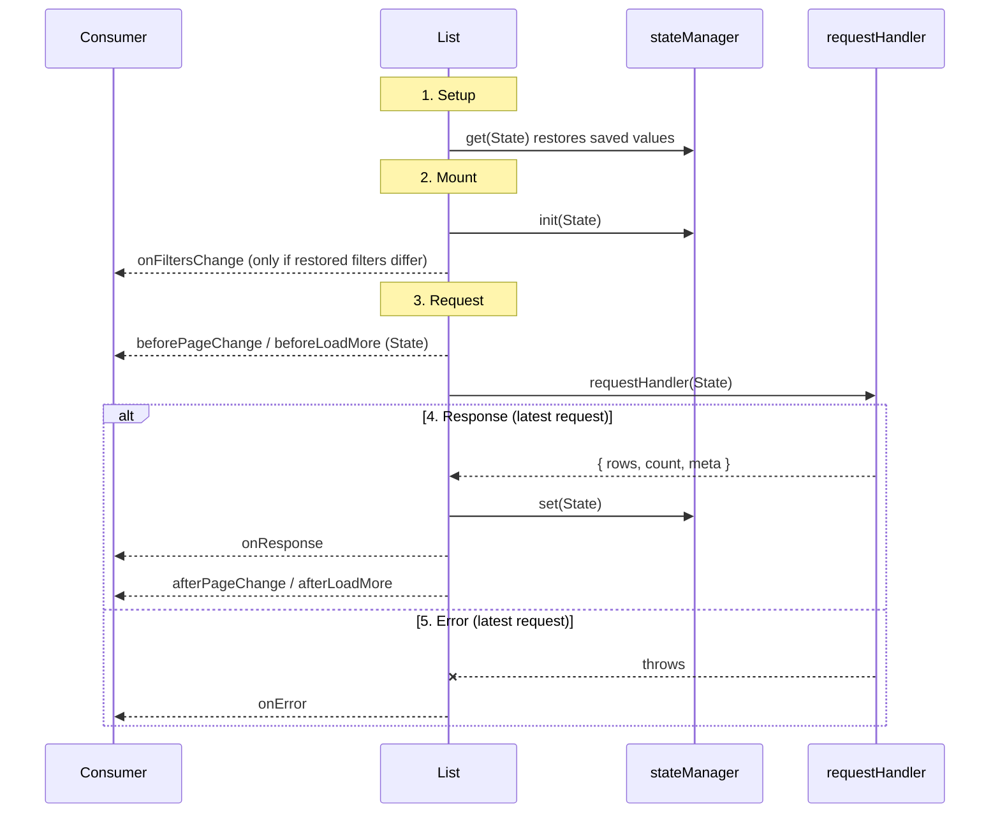

# List lifecycle

How `List` behaves from setup to a response, in both `@shilp.dev/react-list` and `@shilp.dev/vue-list`. The two packages follow the same steps and fire the same hooks in the same order. The matching comments are in `packages/react/src/components/list.tsx` and `packages/vue/src/components/list.vue`.

Hook names are the same in both packages. React takes them as props (`onResponse`, `afterPageChange`, ...). Vue emits them, so the listeners are `@on-response`, `@after-page-change`, ... Payload types live in `shared/types/events.ts`.

## Timeline

## Steps

### 1. Setup (first render)
- State starts from the props and the defaults in `shared/constants.ts`.
- `stateManager.get(state)` runs before any state exists. It may return `page`, `perPage`, `sortBy`, `sortOrder`, `search`, `filters` and `columnSettings`; other fields are ignored.
- A `loadMore` list always starts on page 1, whatever was saved.
- Nothing is fetched yet, and `isInitialLoading` is `true`.

### 2. Mount
1. `stateManager.init(state)`.
2. `onFiltersChange(filters)` if the restored filters differ from the `filters` prop.
3. The first request starts (step 3) for the current page.

### 3. Request
Every fetch goes through these steps: the first load, page, search, sort and filter changes, `loadMore` and `refresh`.
- Only the **latest** request counts. A slower, older response is dropped and fires nothing.
- State: `isLoading = true`, `error = null`, and `isRefresh = true` only for a refresh.
- `beforePageChange(state)` in page mode or `beforeLoadMore(state)` in load-more mode. `state` is the same snapshot passed to `requestHandler`.
- `requestHandler(state)` runs. `state` is data only (no methods); `page` is the page being requested.

### 4. Response
In this order:
1. Rows are replaced in page mode, or appended after page 1 in load-more mode. Each row gets a 1-based `_index` across pages.
2. `count` and `response` (with its `meta`) are stored. `selection` resets to `[]`.
3. `isInitialLoading = false`, `isLoading = false`, `isRefresh = false`.
4. `stateManager.set(state)`.
5. `onResponse(response)`.
6. `afterPageChange(response)` in page mode or `afterLoadMore(response)` in load-more mode.
7. `onRowSelect(selection, previous)` if the reset changed a non-empty selection.

### 5. Error
- `error` is set, `rows` is `[]`, `count` is `0`, and the loading flags are cleared.
- `onError(error)` fires.
- `stateManager.set` and the `after*` hooks do **not** run.
- The error is not re-thrown, so there is no unhandled rejection. Read it from `context.error` or `onError`.

### 6. Actions (called by the consumer)
| Action | Effect |
|---|---|
| `setPage(page)` | Fetches that page. Ignores `0` and `NaN`. |
| `setPerPage`, `setSearch`, `setSortBy`, `setSortOrder` | Go back to page 1 and refetch. `setSearch`, `setSortBy` and `setSortOrder` do nothing if the value is unchanged. |
| `setFilters`, `clearFilters` | Go back to page 1 and refetch, then fire `onFiltersChange`. Nothing happens if the filters are equal. Before the first response, the filters are stored without a refetch. |
| `loadMore` | Fetches the next page, only when `hasMore` and not loading. |
| `refresh` | Refetches the current page with `isRefresh = true`. In load-more mode it clears the rows and starts again from page 1. |
| `setSelection` | Changes `selection`. `onRowSelect` fires when it really changes. |
| `updateRowById(row, id)` | Merges into the row whose `idKey` field equals `id`. No request. Warns if no row matches. |
| `updateColumn` | Changes one column setting and calls `stateManager.set`. No request. |

### 7. Props changing after mount
- A change to `filters`, or to `page`, `perPage`, `search`, `sortBy`, `sortOrder` or `endpoint`, refetches.
- Any change other than `page` goes back to page 1. If `page` changes in the same update, that page is used.
- Changes that arrive **before the first response** are ignored.
- React ignores a `filters` prop that equals the filters already applied, so a parent echoing `onFiltersChange` does not refetch twice.

## Events at a glance

| Event | Fires | Payload |
|---|---|---|
| `beforePageChange` | Before each request in page mode | `State` |
| `beforeLoadMore` | Before each request in load-more mode | `State` |
| `onResponse` | After each successful response | response |
| `afterPageChange` | After `onResponse`, page mode | response |
| `afterLoadMore` | After `onResponse`, load-more mode | response |
| `onError` | When the request fails | `Error` |
| `onRowSelect` | When the selection changes | selection, previous |
| `onFiltersChange` | After `setFilters`, `clearFilters` or a restore that differs from the prop | filters |

## State flags during the lifecycle

| Phase | `isInitialLoading` | `isLoading` | `isRefresh` | `error` | `rows` |
|---|---|---|---|---|---|
| Setup / before first response | `true` | `true` | `false` | `null` | `[]` |
| Later request | `false` | `true` | `true` for a refresh | `null` | previous rows |
| Response | `false` | `false` | `false` | `null` | new rows |
| Error | `false` | `false` | `false` | the error | `[]` |

## What each component shows

| Component | Renders when |
|---|---|
| `ListLoaderInitial` | `isInitialLoading` |
| `ListLoader` | `isLoading` and not `isInitialLoading` |
| `ListError` | `error` and not `isLoading` |
| `ListEmpty` | not initial loading, not loading, no error, and no rows |
| `ListRows`, `ListSummary`, `ListPagination`, `ListPerPage`, `ListGoTo` | not initial loading, rows exist, no error |
| `ListLoadMore` | rows exist and no error |
| `ListRefresh` | not `isInitialLoading` |
| `ListSearch`, `ListColumns` | always |

## Not handled
- An in-flight request is not cancelled when the list unmounts. A stale response is only ignored when a newer request has started.
