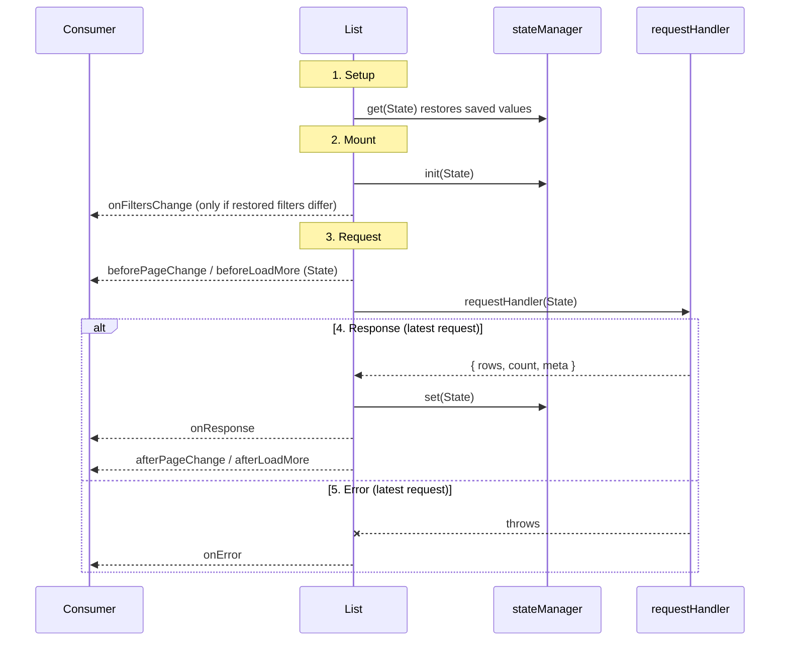

# List lifecycle

How `List` behaves from setup to a response, in both `@shilp.dev/react-list` and `@shilp.dev/vue-list`. The two packages follow the same steps and fire the same hooks in the same order. The matching comments are in `packages/react/src/components/list.tsx` and `packages/vue/src/components/list.vue`.

Hook names are the same in both packages. React takes them as props (`onResponse`, `afterPageChange`, ...). Vue emits them, so the listeners are `@on-response`, `@after-page-change`, ... Payload types live in `shared/types/events.ts`.

## Timeline

## Steps

### 1. Setup (first render)

- State starts from the props and the defaults in `shared/constants.ts`.
- `stateManager.get(state)` runs once, with the State built from the props and defaults, before anything is shown or fetched. React applies what it returns while rendering, so the values before the restore are never committed. It may return `page`, `perPage`, `sortBy`, `sortOrder`, `search`, `filters` and `columns`; other fields are ignored.
- A `loadMore` list always starts on page 1, whatever was saved.
- Nothing is fetched yet, and `isInitialLoading` is `true`.
- With `initialResponse` (a response fetched earlier, for example on the server), the list starts with its `rows`, `count` and `response`, and `isLoading` and `isInitialLoading` are `false`, so the server renders the rows. No hook fires for it.

### 2. Mount

1. `stateManager.init(state)`.
2. `onFiltersChange(filters)` if the saved filters differ from the initial `filters`.
3. The first request starts (step 3) for the current page. It is skipped when the list was seeded with `initialResponse` and `stateManager.get` returned no value. If `get` restored anything, the saved state may ask for a different query, so the list fetches as usual (with the seeded rows shown meanwhile). `clearState` and every later action always fetch.

### 3. Request

Every fetch goes through these steps: the first load, page, search, sort and filter changes, `loadMore` and `refresh`.

- Only the **latest** request counts. A slower, older response is dropped and fires nothing.
- React: an action only sets state and marks a request; the request runs in an effect after that render, so `requestHandler` gets the committed values. The action and its loading flags render once together, and the response renders once more. Two calls in the same event (for example two `loadMore()`) send one request. After the response has rendered, an effect runs `stateManager.set` with the committed State, then `onResponse` and the `after*` hook, in the order of step 4. Vue runs the request inside the action, after setting its refs.
- State: `isLoading = true` and `error = null`. In Vue, `requestTrigger` is `refresh` for a refresh; `isRefresh` no longer exists.
- Vue: `requestTrigger` says what started the request: `mount` for the first one, then the action (`page`, `perPage`, `search`, `sortBy`, `sortOrder`, `filters`, `columns`, `loadMore` or `refresh`). It is set when the action changes something, so `requestHandler` and `before*` get it in `state`.
- `beforePageChange(state)` in page mode or `beforeLoadMore(state)` in load-more mode. `state` is the same snapshot passed to `requestHandler`.
- `requestHandler(state)` runs. `state` is data only (no methods); `page` is the page being requested.

### 4. Response

In this order:

1. Rows are replaced in page mode, or appended after page 1 in load-more mode. Each row gets a 1-based `_index` across pages.
2. `count` and `response` (with its `meta`) are stored. `selection` resets to `[]`.
3. `isInitialLoading = false`, `isLoading = false`.
4. `stateManager.set(state)`.
5. `onResponse(response)`.
6. `afterPageChange(response)` in page mode or `afterLoadMore(response)` in load-more mode.
7. `onRowSelect(selection, previous)` if the reset changed a non-empty selection.

### 5. Error

- `error` is set, `rows` is `[]`, `count` is `0`, and the loading flags are cleared.
- `onError(error)` fires.
- `stateManager.set` and the `after*` hooks do **not** run.
- The error is not re-thrown, so there is no unhandled rejection. Read it from `context.error` or `onError`.

### 6. Actions (called by the consumer)

| Action                                                 | Effect                                                                                                                                                                                                                                                                                                                                       |
| ------------------------------------------------------ | -------------------------------------------------------------------------------------------------------------------------------------------------------------------------------------------------------------------------------------------------------------------------------------------------------------------------------------------- |
| `setPage(page)`                                        | Fetches that page. Ignores `0` and `NaN`. Vue does nothing if it is already the current page (see `PARITY.md`).                                                                                                                                                                                                                              |
| `setPerPage`, `setSearch`, `setSortBy`, `setSortOrder` | Go back to page 1 and refetch. `setSearch`, `setSortBy` and `setSortOrder` do nothing if the value is unchanged.                                                                                                                                                                                                                             |
| `setFilter`, `setFilters`, `clearFilters`              | Fire `onFiltersChange`, then go back to page 1 and refetch. Nothing happens if the filters are equal. Vue `setFilter(column, value)` and `setFilters({ column: value })` merge into the current filters and add a new column; `clearFilters` restores the initial ones. Before the first response, the filters are stored without a refetch. |
| `loadMore`                                             | Fetches the next page, only when `hasMore` and not loading.                                                                                                                                                                                                                                                                                  |
| `refresh`                                              | Refetches the current page with `requestTrigger = 'refresh'`. In load-more mode it clears the rows and starts again from page 1.                                                                                                                                                                                                                       |
| `clearState` | Vue: calls `stateManager.clear(state)` so the saved state can be removed. The list itself is not reset and nothing is fetched. |
| `toggleRowSelection(id)` | Adds the row id (the `idKey` field) to `selection`, or removes it when it is there. `onRowSelect` fires when the selection really changes. The `ListRows` row slot (Vue) and `row` render prop (React) have `isSelected` and `toggleSelection()` for one row. |
| `updateRowById(row, id)`                               | Merges into the row whose `idKey` field equals `id`. No request. Warns if no row matches.                                                                                                                                                                                                                                                    |
| `setColumn(column, key, value)`                        | Vue: sets one key of one column (`visibility`, `label` or a key of your own); an unknown column is ignored. Calls `stateManager.set`, then goes back to page 1 and refetches, except before the first response. Nothing happens if the value is unchanged.                                                                                   |

### 7. Props changing after mount

- React: a change to `filters` refetches and goes back to page 1. Changes that arrive **before the first response** are ignored.
- Vue: `filters` is an initial array of `{ column, value }`, like the query props below; later changes to the prop are ignored (see `PARITY.md`). `State.filters` is an array of `{ column, value, isDirty }`; `isDirty` is true while a value differs from its initial one. `setFilter`, `setFilters`, `clearFilters` and `setColumn` refetch and go back to page 1, except before the first response.
- `page`, `perPage`, `search`, `sortBy`, `sortOrder` and `endpoint` are initial values, read once at setup. To change them later use the actions (`setPage`, `setPerPage`, `setSearch`, `setSortBy`, `setSortOrder`) or `refresh`.
- React ignores a `filters` prop that equals the filters already applied, so a parent echoing `onFiltersChange` does not refetch twice.
- React applies a `filters` change while rendering, so the old values are never committed and the request runs after a single render.

### 8. Unmount

- The request in flight is dropped, as if a newer request had started: no state update, no `stateManager.set` and no hooks.
- The network call itself is not cancelled; `requestHandler` gets no abort signal.

## Events at a glance

| Event              | Fires                                                                      | Payload             |
| ------------------ | -------------------------------------------------------------------------- | ------------------- |
| `beforePageChange` | Before each request in page mode                                           | `State`             |
| `beforeLoadMore`   | Before each request in load-more mode                                      | `State`             |
| `onResponse`       | After each successful response                                             | response            |
| `afterPageChange`  | After `onResponse`, page mode                                              | response            |
| `afterLoadMore`    | After `onResponse`, load-more mode                                         | response            |
| `onError`          | When the request fails                                                     | `Error`             |
| `onRowSelect`      | When the selection changes                                                 | selection, previous |
| `onFiltersChange`  | After `setFilters`, `clearFilters` or a restore that differs from the prop | filters             |

## State flags during the lifecycle

| Phase                         | `isInitialLoading` | `isLoading` | `error`   | `rows`        |
| ----------------------------- | ------------------ | ----------- | --------- | ------------- |
| Setup / before first response | `true`             | `true`      | `null`    | `[]`          |
| Later request                 | `false`            | `true`      | `null`    | previous rows |
| Response                      | `false`            | `false`     | `null`    | new rows      |
| Error                         | `false`            | `false`     | the error | `[]`          |

## What each component shows

| Component                                                              | Renders when                                            |
| ---------------------------------------------------------------------- | ------------------------------------------------------- |
| `ListLoaderInitial`                                                    | `isInitialLoading`                                      |
| `ListLoader`                                                           | `isLoading` and not `isInitialLoading`                  |
| `ListError`                                                            | `error` and not `isLoading`                             |
| `ListEmpty`                                                            | not initial loading, not loading, no error, and no rows |
| `ListRows`, `ListSummary`, `ListPagination`, `ListPerPage`, `ListGoTo` | not initial loading, rows exist, no error               |
| `ListLoadMore`                                                         | rows exist and no error                                 |
| `ListRefresh`                                                          | not `isInitialLoading`                                  |
| `ListSearch`, `ListColumns`                                            | always                                                  |
